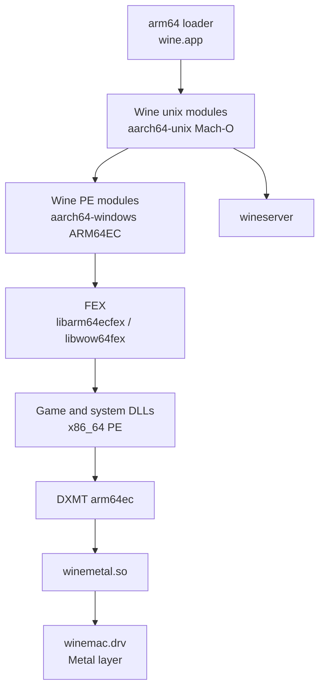

# ARM64 runtime architecture

This document describes how an ARM64 Wine runtime runs an x86_64 Windows program.
It also describes the address space problem that the entitlement solves.
The entitlement-free plan solves the same problem with relocation and fault handling.

## Process model



One Windows process contains native ARM64 code and emulated x86_64 code.
The Wine PE modules that an x86_64 program loads are ARM64EC hybrids.
Some other modules are native AArch64.
The FEX frontend translates x86_64 instructions at run time.
DXMT is an ARM64X payload, so the emulated game calls native Direct3D code.
`winemetal.so` is a native arm64 unix module that talks to Metal.

## Components

| Component                                 | Architecture | Role                                            |
| ----------------------------------------- | ------------ | ----------------------------------------------- |
| `wine` loader                             | Mach-O arm64 | Creates the process and loads the unix modules. |
| `ntdll.so`, `winemac.so`, `win32u.so`     | Mach-O arm64 | Unix side of the Windows API.                   |
| `ntdll.dll`, `kernel32.dll`, `win32u.dll` | PE ARM64EC   | Windows side of the API.                        |
| `libarm64ecfex.dll`                       | PE ARM64EC   | x86_64 translation for 64-bit programs.         |
| `libwow64fex.dll`                         | PE ARM64     | i386 translation through WoW64.                 |
| `xtajit64.dll`, `xtajit.dll`              | PE ARM64     | Wine names for the emulator modules.            |
| `d3d11.dll`, `dxgi.dll`, `d3d10core.dll`  | PE ARM64X    | DXMT frontends.                                 |
| `winemetal.dll`                           | PE ARM64X    | DXMT Metal bridge.                              |
| `winemetal.so`                            | Mach-O arm64 | Metal access from the unix side.                |

Wine loads the emulator from the registry values `HKLM\Software\Microsoft\Wow64\amd64` and `\x86`.
The values must name the FEX modules, or the loader must install them under the `xtajit` names.
The current WineCX ARM64 branch does not add these values. MetalSharp-Wine patch 0004 adds them.
Packaging can also replace `xtajit64.dll` and `xtajit.dll` with the FEX modules.

## Address space

### The macOS reservation

A native ARM64 process on macOS reserves the low 4 GB as `PAGEZERO`.
Windows needs two regions in that range:

- `KUSER_SHARED_DATA` at `0x7ffe0000`.
- The 32-bit guest address space below 4 GB, when WoW64 runs i386 programs.

WineCX ARM64 handles the reservation in `dlls/ntdll/unix/virtual.c`:

```c
/* A loader signed with com.apple.developer.cross-architecture-support
 * is allowed to give it back; without the entitlement the deallocate fails
 * and nothing below 4GB is ever mappable. */
static void free_pagezero(void) { ... mach_vm_deallocate(...) ... }
```

The loader must have an explicit 4 GB `__PAGEZERO` segment for this function to find.
If the deallocation fails, `virtual_map_user_shared_data()` cannot map `0x7ffe0000`.
That function calls `exit(1)` on failure, so the runtime stops before the first window.

### The entitlement-free layout

MetalSharp-Wine moves the shared page instead of the reservation:

| Step     | Change                                                                                                  |
| -------- | ------------------------------------------------------------------------------------------------------- |
| Probe    | Try to map `0x7ffe0000` without `MAP_FIXED`. If it fails, the low 4 GB is not available.                |
| Relocate | Map the shared page at `0x17ffe0000`, which is 4 GB above the canonical address.                        |
| Publish  | Export `__wine_user_shared_data` from PE ntdll and `ntdll_get_user_shared_data()` from unix ntdll.      |
| Emulate  | In the `SIGSEGV` handler, decode ARM64 loads from `0x7ffe0000` and redirect them to the relocated page. |

The emulation covers ordinary loads and the `LDAPUR` forms that an x86 emulator emits for TSO.
Patches 0003, 0005, 0008, and 0016 in MetalSharp-Wine implement this layout.
Patch 0018 keeps the standard layout when the process does have the entitlement.

### Consequence for i386

Without the entitlement, the region above 4 GB is available for the relocated page.
The low 4 GB stays reserved, so 32-bit programs cannot work.
The ARM64 lane therefore ships 64-bit only.
This matches the existing `--require-64-bit-only` policy.

## Memory protection

macOS does not grant a page write and execute permission together without `MAP_JIT`.
Windows code expects writable and executable pages.
WineCX and the reference solve the difference with faults:

1. Map executable pages as read and execute.
2. On a write fault, change the host page to read and write.
3. On an execute fault, change the host page back to read and execute and invalidate the instruction cache.
4. Keep the write protection of each 4K Windows page exact inside a 16K host page.

A normal Terminal delivers these protection faults.
The agent shell used for earlier probes suppresses synchronous signals, so a
faulting process hangs there.
Measure fault behavior from a normal Terminal.

The lane maps FEX code buffers with `MAP_JIT`: the unix library keeps them `rwx`
and FEX toggles `pthread_jit_write_protect_np` around JIT writes.
Wine keeps the 4K write-protection rule for guest pages.
See [results](results.md#16k-host-pages-and-the-jit-code-buffer).

WineCX ARM64 has a writable and executable flip for the CodeWeavers hacks.
MetalSharp-Wine replaces it with a more complete fault path.
The lane keeps the WineCX path for mixed PE host pages.

Host pages are 16K on Apple Silicon.
A 4K page mode exists on macOS 26 and later, but it needs the entitlement.
The ARM64 lane therefore uses 16K pages and emulates 4K granularity.
Patch 0011 and patch 0019 only apply to an entitled process.

## CPU and startup

| Topic           | Detail                                                                                                             |
| --------------- | ------------------------------------------------------------------------------------------------------------------ |
| Thread pointer  | Windows ARM64 keeps the TEB in `x18`. macOS clears `x18` on some transitions. Wine reloads it in the syscall path. |
| Build version   | MetalSharp-Wine reports a build version of macOS 12.0 for the loader, which its measurements show preserves `x18`. |
| CPU features    | macOS does not let user code read the ARM64 ID registers. Wine builds them from the `hw.optional.arm.*` sysctls.   |
| FEX features    | FEX reads the synthesized registers to select LSE, LRCPC, AFP, and other paths.                                    |
| TSO             | FEX emulates the x86 memory ordering model by default. Some programs need it. It costs performance.                |
| Synchronization | `WINEMSYNC=1` selects msync. The current client sets it by default.                                                |

## What WineCX ARM64 already provides

| Area                    | State in `arm64-1117`                  | Still needed                         |
| ----------------------- | -------------------------------------- | ------------------------------------ |
| Low 4 GB release        | `free_pagezero()` with the entitlement | Relocation for an unentitled process |
| Shared page mapping     | Fixed at `0x7ffe0000`                  | Probe and relocation                 |
| Shared page loads       | No emulation                           | Fault handler                        |
| Write and execute pages | CodeWeavers flip                       | Evaluate, then fill gaps             |
| ARM64 D3DMetal hooks    | Present                                | None                                 |
| Client surface presents | Present                                | None                                 |
| Driver heap fallback    | Present                                | None                                 |
| Metal shader cache      | Per process                            | None                                 |
| FEX wiring              | None                                   | Registry values or file aliases      |
| CPU ID registers        | None                                   | Synthesized registers                |
| Loader build version    | Default SDK                            | Evaluate the `x18` effect            |

## Limits

| Limit              | Reason                                                |
| ------------------ | ----------------------------------------------------- |
| No i386            | The low 4 GB is not mappable without the entitlement. |
| No 4K host pages   | The page size request needs the entitlement.          |
| 16K page emulation | The host page is larger than the Windows page.        |
| Emulated x86_64    | FEX translates every x86_64 instruction.              |
| No x86_64 Wine     | The lane is ARM64 only.                               |

These limits are acceptable for Arknights, which is a 64-bit game.
They are not acceptable for a general-purpose Wine runtime.
