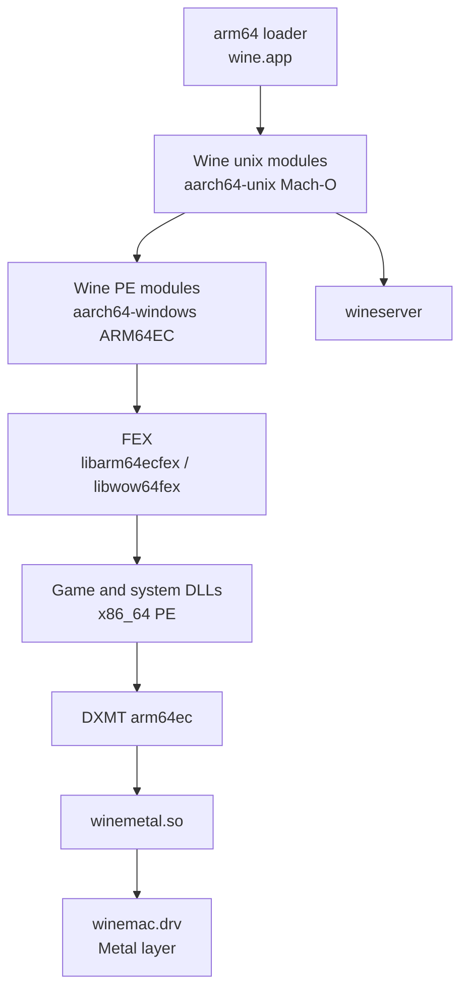

# ARM64 runtime architecture

This document describes how an ARM64 Wine runtime runs an x86_64 Windows program. It also covers the
address-space problem that the entitlement solves and the entitlement-free replacement.

## Process model

One Windows process contains native ARM64 and emulated x86_64 code. The Wine PE modules that an x86_64
program loads are ARM64EC hybrids; other modules are native AArch64. FEX translates x86_64
instructions at run time. DXMT is an ARM64X payload, so the emulated game calls native Direct3D code.
`winemetal.so` is a native arm64 unix module that talks to Metal.

## Components

| Component                                 | Architecture | Role                                            |
| ----------------------------------------- | ------------ | ----------------------------------------------- |
| `wine` loader                             | Mach-O arm64 | Creates the process and loads the unix modules. |
| `ntdll.so`, `winemac.so`, `win32u.so`     | Mach-O arm64 | Unix side of the Windows API.                   |
| `ntdll.dll`, `kernel32.dll`, `win32u.dll` | PE ARM64EC   | Windows side of the API.                        |
| `libarm64ecfex.dll`                       | PE ARM64EC   | x86_64 translation for 64-bit programs.         |
| `libwow64fex.dll`                         | PE ARM64     | i386 translation through WoW64.                 |
| `xtajit64.dll`, `xtajit.dll`              | PE ARM64     | Wine names for the emulator modules.            |
| `d3d11.dll`, `dxgi.dll`, `d3d10core.dll`  | PE ARM64X    | DXMT frontends.                                 |
| `winemetal.dll`                           | PE ARM64X    | DXMT Metal bridge.                              |
| `winemetal.so`                            | Mach-O arm64 | Metal access from the unix side.                |

Wine loads the emulator from `HKLM\Software\Microsoft\Wow64\amd64` and `\x86`. The values must name the
FEX modules, or packaging must install them under the `xtajit64.dll` and `xtajit.dll` names. WineCX
does not add the values; the `fex` patch does. Use one method only.

## Address space

### macOS reservation

A native ARM64 process reserves the low 4 GB as `PAGEZERO`. Windows needs two regions there:
`KUSER_SHARED_DATA` at `0x7ffe0000`, and the 32-bit guest address space for WoW64.

WineCX handles the reservation in `dlls/ntdll/unix/virtual.c`. `free_pagezero()` deallocates the
loader's explicit 4 GB `__PAGEZERO` segment. Without the entitlement, the deallocation fails.
`virtual_map_user_shared_data()` then cannot map `0x7ffe0000` and calls `exit(1)` before the first
window.

### Entitlement-free layout

| Step     | Change                                                                                                  |
| -------- | ------------------------------------------------------------------------------------------------------- |
| Probe    | Try to map `0x7ffe0000` without `MAP_FIXED`. If it fails, the low 4 GB is not available.                |
| Relocate | Map the shared page at `0x17ffe0000`, 4 GB above the canonical address.                                 |
| Publish  | Export `__wine_user_shared_data` from PE ntdll and `ntdll_get_user_shared_data()` from unix ntdll.      |
| Emulate  | In the `SIGSEGV` handler, decode ARM64 loads from `0x7ffe0000` and redirect them to the relocated page. |

The emulation covers ordinary loads and the `LDAPUR` forms that an x86 emulator emits for TSO.
Patches `0003`, `0005`, `0008`, and `0016` implement it. Patch `0018` keeps the standard layout when
the process has the entitlement. A 64-bit image with a preferred base below 4 GB uses the probed floor
instead of the reserved low range.

### i386

The region above 4 GB is available, but the low 4 GB stays reserved. 32-bit programs cannot run, so
the lane is 64-bit only. This matches the `--require-64-bit-only` policy.

## Memory protection

macOS does not grant write and execute permission together without `MAP_JIT`. WineCX and the
reference solve this with faults:

1. Map executable pages as read and execute.
2. On a write fault, make the host page read and write.
3. On an execute fault, make it read and execute and invalidate the instruction cache.
4. Keep the 4K Windows write protection exact inside a 16K host page.

The lane keeps WineCX's writable and executable flip for mixed PE host pages; the reference has a more
complete fault path. Measure fault behavior from a normal Terminal. The agent shell used for earlier
probes suppresses synchronous signals, so a faulting process hangs there.

FEX code buffers are different. The `map-jit` patch keeps them `rwx` with `MAP_JIT`, and FEX toggles
`pthread_jit_write_protect_np` around writes. Wine keeps the 4K write-protection rule for guest pages.

Host pages are 16K on Apple Silicon. A 4K page mode exists on macOS 26 and later, but it needs the
entitlement. Patches `0011` and `0019` apply only to an entitled process.

## CPU and startup

| Topic           | Detail                                                                                                             |
| --------------- | ------------------------------------------------------------------------------------------------------------------ |
| Thread pointer  | Windows ARM64 keeps the TEB in `x18`. macOS clears `x18` on some transitions. Wine reloads it in the syscall path. |
| Build version   | MetalSharp-Wine reports a build version of macOS 12.0 for the loader, which its measurements show preserves `x18`. |
| CPU features    | macOS does not let user code read the ARM64 ID registers. Wine builds them from the `hw.optional.arm.*` sysctls.   |
| FEX features    | FEX reads the synthesized registers to select LSE, LRCPC, AFP, and other paths.                                    |
| TSO             | FEX emulates the x86 memory ordering model by default. Some programs need it. It costs performance.                |
| Synchronization | `WINEMSYNC=1` selects msync. The current client sets it by default.                                                |

## Limits

| Limit              | Reason                                                |
| ------------------ | ----------------------------------------------------- |
| No i386            | The low 4 GB is not mappable without the entitlement. |
| No 4K host pages   | The page size request needs the entitlement.          |
| 16K page emulation | The host page is larger than the Windows page.        |
| Emulated x86_64    | FEX translates every x86_64 instruction.              |
| No x86_64 Wine     | The lane is ARM64 only.                               |

These limits are acceptable for Arknights, a 64-bit game. They are not acceptable for a general Wine
runtime.
