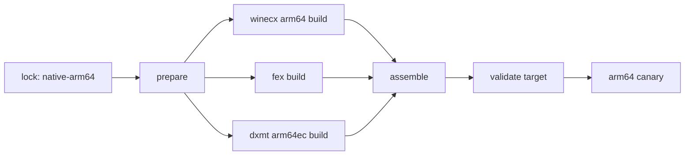

# Two-target build pipeline

This document describes a second build target in this repository.
The current target stays unchanged.
The new target builds the native ARM64 runtime.
The lock schema and the target-aware `prepare` and `validate-lock` commands exist.
The build and release commands are proposals.

## Lock shape

`runtime.lock.json` gains a target dimension.
The archive schema stays at version 2, so the consumer contract does not change.
The top level holds the default target's pins.

```json
{
    "schemaVersion": 3,
    "archiveSchemaVersion": 2,
    "defaultTarget": "rosetta-x86_64",
    "deploymentTarget": "15.0",
    "sources": { "wine": {}, "dxmt": {} },
    "baseArtifact": {},
    "interface": {},
    "patches": [],
    "targets": {
        "rosetta-x86_64": {},
        "native-arm64": {
            "sources": { "wine": {}, "dxmt": {}, "fex": {} },
            "baseArtifact": null,
            "interface": {}
        }
    }
}
```

A `targets` entry replaces whole keys: `deploymentTarget`, `sources`, `interface`, and `baseArtifact`.
An absent key is inherited from the top level.
`baseArtifact` set to `null` means the target builds every component.
`load_lock()` validates every target and returns the resolved view of one target.
Without an argument it resolves `defaultTarget`.

| Field          | Rosetta target                  | ARM64 target                              |
| -------------- | ------------------------------- | ----------------------------------------- |
| `sources.wine` | `winecx` `wine1117`             | `winecx` `arm64-1117`                     |
| `sources.dxmt` | Current pin                     | Same pin or a newer ARM64EC commit        |
| `sources.fex`  | Absent                          | `dappermint/FEX` `main`                   |
| `baseArtifact` | Whisky 4.7.3 archive            | Absent, the target builds every component |
| `interface`    | `x86_64-unix`, `x86_64-windows` | `aarch64-unix`, `aarch64-windows`         |

Patches stay at the top level of the lock.
Add an optional `targets` list to each patch entry.
A patch without the list applies to all targets.
The ACE Rosetta patch applies to `rosetta-x86_64` only, because it changes `signal_x86_64.c`.

`prepare` keeps the legacy source directory name for the default target.
Another target adds its name: `wine-native-arm64-combined`.
`update-pins` still rewrites the top-level pins only.
Extend it with the target before the ARM64 lane builds.

## Commands

| Command                                                                            | Purpose                                   |
| ---------------------------------------------------------------------------------- | ----------------------------------------- |
| `uv run --locked scripts/shared/runtime.py validate-lock`                          | Validate every target.                    |
| `uv run --locked scripts/shared/runtime.py validate-lock --target native-arm64`    | Validate the lock and resolve one target. |
| `uv run --locked scripts/shared/runtime.py prepare combined --target native-arm64` | Clone and patch the ARM64 sources.        |
| `just build-arm64`                                                                 | Build a canary ARM64 artifact.            |
| `just verify-arm64`                                                                | Validate the artifact.                    |
| `just build-release`                                                               | Build the release artifacts.              |

A command without `--target` keeps its current behavior.
The default target is `rosetta-x86_64` until the ARM64 canary passes.

## Build stages



### 1. Prepare

```sh
uv run --locked scripts/shared/runtime.py validate-lock
uv run --locked scripts/shared/runtime.py prepare combined --target native-arm64
```

Prepare clones each source at its pinned commit.
It applies the patch list for the target in order.
It rejects a patch that does not apply without fuzz.

### 2. WineCX

```sh
"$wine_source/configure" \
  --host=aarch64-apple-darwin \
  --enable-archs=arm64ec,aarch64 \
  --disable-tests \
  --without-x --without-wayland --without-oss --without-alsa --without-pulse \
  --without-sane --without-usb --without-v4l2 --without-pcap --without-capi \
  --without-opencl --without-cups \
  --without-ffmpeg --without-gstreamer \
  --prefix=/opt/whiskywine
make -j"$(sysctl -n hw.logicalcpu)"
make install DESTDIR="$stage"

wine_install="$stage/opt/whiskywine"
```

The build needs these tools:

| Tool                                                            | Purpose                                   |
| --------------------------------------------------------------- | ----------------------------------------- |
| Xcode and the macOS SDK                                         | Host compiler and frameworks.             |
| Bison 3 or later, flex, pkg-config                              | Wine build tools. macOS bison is too old. |
| llvm-mingw with `arm64ec-w64-mingw32` and `aarch64-w64-mingw32` | PE cross compilation.                     |
| FreeType and GnuTLS development files                           | Wine dependencies.                        |
| ccache                                                          | Repeat builds.                            |

Use a pinned llvm-mingw release.
The reference recipe notes that the Homebrew `mingw-w64` package is x86 only.

### 3. FEX

The PE modules:

```sh
cmake -S "$fex_source" -B "$fex_arm64ec" -G Ninja \
  -DCMAKE_TOOLCHAIN_FILE="$fex_source/Data/CMake/toolchain_mingw.cmake" \
  -DMINGW_TRIPLE=arm64ec-w64-mingw32 \
  -DCMAKE_BUILD_TYPE=Release -DENABLE_LTO=FALSE -DBUILD_TESTING=FALSE \
  -DENABLE_OFFLINE_TELEMETRY=FALSE \
  -DCMAKE_INSTALL_PREFIX="$fex_install"
cmake --build "$fex_arm64ec"
cmake --install "$fex_arm64ec"

cmake -S "$fex_source" -B "$fex_wow64" -G Ninja \
  -DCMAKE_TOOLCHAIN_FILE="$fex_source/Data/CMake/toolchain_mingw.cmake" \
  -DMINGW_TRIPLE=aarch64-w64-mingw32 \
  -DCMAKE_BUILD_TYPE=Release -DENABLE_LTO=FALSE -DBUILD_TESTING=FALSE \
  -DENABLE_OFFLINE_TELEMETRY=FALSE \
  -DCMAKE_INSTALL_PREFIX="$fex_install"
cmake --build "$fex_wow64"
cmake --install "$fex_wow64"
```

The unix bridges:

```sh
clang++ -std=c++20 -O2 -shared -fPIC -arch arm64 \
  -mmacosx-version-min=15.0 \
  -I"$fex_source/Source/Windows/UnixLib" \
  "$fex_source/Source/Windows/UnixLib/FEXUnixLib.cpp" \
  -o "$wine_install/lib/wine/aarch64-unix/libarm64ecfex.so"

clang++ -std=c++20 -O2 -shared -fPIC -arch arm64 \
  -mmacosx-version-min=15.0 \
  -I"$fex_source/Source/Windows/UnixLib" \
  "$fex_source/Source/Windows/UnixLib/FEXUnixLib.cpp" \
  -o "$wine_install/lib/wine/aarch64-unix/libwow64fex.so"
```

Install the two PE modules into `lib/wine/aarch64-windows`.
The install prefix of the cross build is `$fex_install`; the files are in its `lib` directory.

```sh
cp "$fex_install/lib/libarm64ecfex.dll" "$wine_install/lib/wine/aarch64-windows/"
cp "$fex_install/lib/libwow64fex.dll" "$wine_install/lib/wine/aarch64-windows/"
```

The FEX top-level CMake file rejects macOS.
Use the cross toolchain file for the PE build and the direct compile for the unix bridge.
The reference for both is `metalsharp/MetalSharp-Wine` at `scripts/build-fex.sh`.

The arm64ec triple selects the hybrid ABI on its own.
Do not add `-marm64x`; that flag emits ARM64X objects instead of ARM64EC objects.
mingw's `winnt.h` declares `RtlIsEcCode` only for `__x86_64__`.
Force-include a header that declares it for the arm64ec build.
Do not define `__x86_64__`; it pulls the x86 intrinsic surface into the compile.
The forced include must skip assembly files.

### 4. DXMT

```sh
meson setup "$dxmt_build" "$dxmt_source" \
  --cross-file "$dxmt_source/build-arm64ec.txt" \
  -Dnative_llvm_path="$llvm15_arm64" \
  -Dwine_build_path="$wine_build" \
  --buildtype release --prefix "$dxmt_install" --strip
meson compile -C "$dxmt_build"
meson install -C "$dxmt_build"
```

`airconv` needs LLVM 15 with typed pointers.
Build LLVM 15 for arm64 with static libraries and no tools.
The reference build is `dappermint/winecx-gptk` at `arm64/build-llvm15.sh`.

Meson ignores `MACOSX_DEPLOYMENT_TARGET`.
Pass a native file that sets `-mmacosx-version-min` to the lock value.
The native `winemetal.so` then matches the deployment target.
The cross file keeps `-marm64x`; DXMT loads as ARM64X in both process types.

### 5. Assemble

```text
Libraries/
  Wine/
    bin/
      Arknights -> wine64
      wine      -> ../lib/wine/aarch64-unix/wine
      wine64    -> wine
      wineloader -> wine
      wineserver
    lib/wine/aarch64-unix/
      wine                    # loader
      *.so                    # ntdll, winemac, win32u, coreaudio, ...
      libarm64ecfex.so
      libwow64fex.so
      winemetal.so
    lib/wine/aarch64-windows/
      *.dll                   # ARM64X PE modules
      libarm64ecfex.dll
      libwow64fex.dll
      winemetal.dll
    share/wine/
      wine.inf, nls, fonts
  DXMT/x64/
    d3d10core.dll
    d3d11.dll
    dxgi.dll
    winemetal.dll
  runtime-capabilities-arm64.json
```

Rules:

1. Do not ship `lib/wine/i386-windows`.
2. Do not ship `lib/wine/x86_64-unix` or `lib/wine/x86_64-windows`.
3. Do not ship GStreamer or FFmpeg.
4. Keep `winemetal.dll` as a builtin module in the Wine tree.
5. Clear the Wine builtin marker at offset 64 in the three native DXMT libraries.
6. Sign every Mach-O file ad hoc.
7. Do not request an entitlement.

The reference runtime wraps the loader in `wine.app` because its signature carries a provisioning profile.
The entitlement-free build installs a plain loader at `lib/wine/aarch64-unix/wine`.
Do not copy the reference app bundle.

Copy the DXMT files in two steps:

```sh
cp "$dxmt_install/aarch64-windows/winemetal.dll" "$wine_install/lib/wine/aarch64-windows/"
cp "$dxmt_install/aarch64-unix/winemetal.so" "$wine_install/lib/wine/aarch64-unix/"
for library in d3d10core.dll d3d11.dll dxgi.dll; do
  cp "$dxmt_install/aarch64-windows/$library" "$candidate/DXMT/x64/$library"
done
```

DXMT names its install directories from `cpu_family`.
The ARM64EC cross file sets `cpu_family` to `aarch64` and passes `-marm64x`.

### 6. Validate

Extend `scripts/shared/validate_runtime.py` with a target parameter:

| Check                   | Rosetta target                  | ARM64 target                      |
| ----------------------- | ------------------------------- | --------------------------------- |
| Required Mach-O files   | `x86_64`                        | `arm64`                           |
| Required PE files       | `x86-64`                        | ARM64EC                           |
| Wine module directories | `x86_64-unix`, `x86_64-windows` | `aarch64-unix`, `aarch64-windows` |
| Legacy payloads         | Reject                          | Reject                            |
| Deployment target       | Lock value                      | Lock value                        |
| Dependency references   | Relocatable                     | Relocatable                       |
| Entitlement             | Not checked                     | Reject a loader that needs one    |

The `file` command reports ARM64EC and AArch64 PE files with the same label.
Read the machine type from the PE header for the architecture check.

Add one check for the emulator wiring:
the artifact must contain either the FEX registry values or the `xtajit` aliases, and the named modules must exist.

### 7. Release

Use separate artifact names and one provenance file per target:

```text
Arknights-MacOS-Runtime-vX.Y.Z.tar.gz
Arknights-MacOS-Runtime-arm64-vX.Y.Z.tar.gz
```

`provenance.json` gains a `target` field.
The native-arm64 artifact ships `runtime-capabilities-arm64.json`.
It differs from the x86_64 manifest in `aceCompat` and `nativeArm64`.
Keep the ARM64 artifact out of the release until the manual canary passes.

## Signing and distribution

The project has no paid Apple Developer account.
Neither target needs one, because no artifact uses the cross-architecture entitlement.

| Item               | Rule                                                              |
| ------------------ | ----------------------------------------------------------------- |
| Signing            | Sign every Mach-O file ad hoc: `codesign --force --sign -`.       |
| Notarization       | None. Notarization needs a paid Developer ID certificate.         |
| Entitlement        | Never request one for a distributed artifact.                     |
| i386, 4K pages     | Out of scope. Both need the entitlement.                          |
| First-launch trust | The user completes Apple's **Open Anyway** flow for the launcher. |

The launcher extracts the archive into application support.
The launcher writes those files, so macOS does not quarantine them.
The runtime therefore starts without a second trust prompt.

The client publishes ad-hoc signed, non-notarized releases already.
See `docs/development/releases-and-updates.md` in that repository.
The ARM64 lane adds no signing requirement to that model.

Ad-hoc signing does not change the redistribution terms.
`provenance.json` records the pinned sources and the artifact hashes per target.
The source offer stays as it is.

Three conditions would break this model:

1. macOS requires notarization for every executable, not only downloaded apps.
2. Apple changes the 16K page or `PAGEZERO` behavior for unentitled processes.
3. The client stops shipping an ad-hoc signed launcher.

The first two affect both targets, not only ARM64.

If Gatekeeper blocks a user, the fallback is a local build.
`just build-release` on the user's Mac produces an artifact that macOS did not quarantine.

A free Apple ID cannot authorize a distributed artifact.
Apple documents `com.apple.developer.cross-architecture-support-unmanaged` for free accounts, but it is unreachable today.
If Apple opens it, the profile stays bound to one team, one App ID, and one Mac.
Use it only for a local canary with i386 or 4K pages, and never ship the result.
See [provenance](provenance.md#entitlement-availability).

## CI

| Job                   | Runner             | Target           |
| --------------------- | ------------------ | ---------------- |
| Lock and patch checks | `ubuntu-24.04`     | Both             |
| Rosetta build         | `xcode-27`         | `rosetta-x86_64` |
| ARM64 canary          | ARM64 macOS runner | `native-arm64`   |
| Release               | ARM64 macOS runner | Selected target  |

Confirm that the `xcode-27` runner label resolves to Apple Silicon before the first ARM64 job.
The x86_64 lane uses `x86_64-darwin` Nix packages for Wine.
The ARM64 lane resolves the same packages for `aarch64-darwin` from the locked nixpkgs commit.
Both lanes bundle the library closure from `/nix/store`.

## Rollout

| Stage       | Gate                                                 |
| ----------- | ---------------------------------------------------- |
| Lock schema | `just check` passes for both targets.                |
| Wine build  | The loader starts `wineboot` without an entitlement. |
| DXMT        | A Direct3D 11 sample runs.                           |
| Canary      | The game reaches the login screen and passes ACE.    |
| Release     | Manual checks pass on macOS 15, 26, and 27.          |

The Rosetta target remains the default at every stage.
